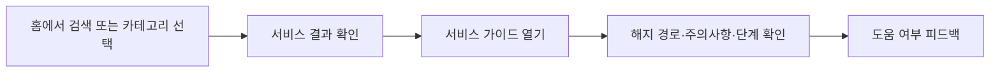
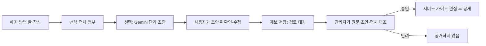
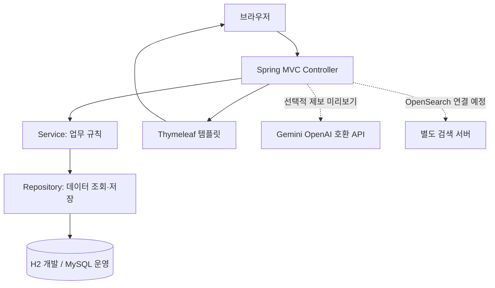

# 구독 해지 가이드 프로젝트 안내

사람과 새로 합류한 팀원이 이 저장소가 **무엇을 만들고, 어떤 기술로 동작하며, 지금 어디까지 구현됐는지** 빠르게 파악하도록 돕는 문서입니다.

- 기준일: 2026-11-26
- 내용 기준: 이 저장소의 현재 `main` 작업 폴더와 인계 문서
- 상태 표기: **구현됨**은 현재 코드에서 확인한 기능, **예정**은 기획·설계만 있고 현재 코드에 연결되지 않은 기능입니다.

## 1. 프로젝트 한눈에 보기

| 항목 | 내용 |
|---|---|
| 이름 | 구독 해지 가이드 |
| 한 줄 소개 | 한국의 구독 서비스 해지 방법을 검색하고 단계별로 확인하는 정보 웹사이트 |
| 주 사용자 | 구독을 해지하려는 사람, 해지 경험을 공유하는 제보자, 가이드를 검토·관리하는 관리자 |
| 서비스 형태 | 반응형 웹사이트와 설치형 PWA 지원 |
| 현재 코드 | 공개 가이드·검색·카테고리·피드백·제보·관리자 검토 기능 구현 |
| 운영 상태 | Railway와 실제 MySQL 환경에서의 배포 및 제보 검증이 남아 있음 |

이 사이트는 사용자의 구독을 직접 조회하거나 해지를 대신 처리하지 않습니다. 공개된 가이드에 따라 사용자가 각 구독 서비스에서 직접 해지하도록 돕습니다.

## 2. 해결하려는 문제와 제품 원칙

구독 서비스마다 해지 메뉴의 위치와 결제 경로가 다릅니다. 앱, 웹사이트, Apple App Store, Google Play 중 어디에서 결제했는지에 따라 해지 위치가 달라질 수도 있습니다. 한 서비스의 방법도 화면 개편에 따라 바뀝니다.

이 프로젝트는 서비스별 방법을 한곳에 모으고, 방문자가 검색 결과에서 실제 경로·주의점·단계를 바로 확인하도록 합니다. 정보가 오래되거나 틀릴 수 있으므로 확인일과 사용자 피드백을 함께 관리합니다.

제품 원칙은 다음과 같습니다.

1. 이용자는 회원가입 없이 검색과 가이드를 볼 수 있습니다.
2. 각 가이드에는 확인일과 가능한 해지 경로를 표시합니다.
3. AI 결과는 공개 정보가 아니라 **관리자가 검토할 초안**입니다.
4. 실제 화면을 복제하는 대신 메뉴와 선택 위치를 단순한 도식으로 보여줍니다.
5. API 키, 관리자 비밀번호, 데이터베이스 자격 증명은 문서나 Git에 기록하지 않습니다.

## 3. 누가 무엇을 하는가

| 사용자 | 하려는 일 | 사이트가 제공하는 것 |
|---|---|---|
| 방문자 | 서비스 이름이나 일부 이름으로 가이드를 찾는다 | 홈, 검색 결과, 카테고리, 해지 단계와 주의사항 |
| 제보자 | 사이트에 없는 방법이나 변경 내용을 알린다 | 글 입력, 선택 캡처 업로드, AI 단계 미리보기, 제보 제출 |
| 관리자 | 정보를 확인하고 공개 자료를 최신으로 유지한다 | 서비스·카테고리·단계 관리, 제보와 캡처 검토, 승인·반려 |

## 4. 현재 화면과 기능

### 방문자 화면

| 주소 | 기능 | 상태 |
|---|---|---|
| `/` | 검색창, 카테고리별 서비스 목록 | 구현됨 |
| `/category/{slug}` | 카테고리에 속한 서비스 목록과 페이지 나누기 | 구현됨 |
| `/search?q=검색어` | 서비스 이름 또는 slug를 대소문자 구분 없이 부분 검색 | 구현됨 |
| `/guide/{slug}` | 확인일, 해지 경로·주의사항, 단계별 안내 도식, 도움이 됐는지 피드백 | 구현됨 |
| `/submit` | 해지 방법, 채널·주의사항, 아이콘과 최대 5개 캡처를 제보 | 구현됨 |
| `/submit/preview` | 작성 글과 선택 캡처를 바탕으로 AI 단계 초안을 미리 보고 수정 | Gemini 키가 설정된 경우 구현됨 |
| `/submit/done` | 제보 완료 안내 | 구현됨 |
| `/sitemap.xml`, `/robots.txt` | 검색엔진용 사이트맵과 크롤링 규칙 | 구현됨 |

현재 검색은 DB에 있는 한글 서비스 이름과 slug의 부분 일치 검색입니다. `유` 같은 짧은 접두어, 영문 별칭, `우투브` 같은 오타 보정, 자동완성은 **현재 main 코드에서 확인되지 않았습니다**. 이를 위한 별도 OpenSearch 연동은 승인된 설계·계획 문서가 있지만 아직 코드에 구현되지 않았습니다.

### 관리자 화면

| 주소 | 기능 | 상태 |
|---|---|---|
| `/admin/login` | 관리자 로그인 | 구현됨 |
| `/admin/guides` | 서비스 검색·목록, 가이드 편집 진입 | 구현됨 |
| `/admin/guides/new` | 서비스 등록 | 구현됨 |
| `/admin/guides/{id}/edit` | 서비스 정보·주의사항·아이콘 관리 | 구현됨 |
| `/admin/guides/{id}/steps/...` | 해지 단계 추가·수정·삭제 | 구현됨 |
| `/admin/categories` | 카테고리 추가·이름 변경·삭제 | 구현됨 |
| `/admin/submissions` | 대기 중인 제보 목록과 상세 검토 | 구현됨 |
| `/admin/submissions/{id}/approve` | 새 서비스로 승인하고 편집 화면으로 이동 | 구현됨 |
| `/admin/submissions/{id}/approve-existing` | 기존 서비스에 제보를 연결해 승인 | 구현됨 |
| `/admin/submissions/{id}/reject` | 제보 반려 | 구현됨 |

관리자 경로는 Spring Security에서 `ADMIN` 권한으로 제한합니다. 운영 환경은 `ADMIN_PASSWORD` 환경변수가 필요합니다. 실제 자격 증명은 이 문서나 채팅에 적지 않습니다.

### 현재 샘플 데이터

개발용 초기 데이터에는 OTT·음악 등 6개 카테고리와 넷플릭스·티빙·멜론 서비스가 있습니다. 현재 초기 단계는 넷플릭스 3단계와 멜론 3단계입니다. 티빙을 포함한 나머지 서비스의 가이드는 운영 데이터에서 관리자 검증 후 작성해야 합니다. 이 숫자는 초기 데이터 기준이며 관리자가 바꾸면 달라질 수 있습니다.

## 5. 주요 사용자 흐름

### 가이드 찾기



### 제보에서 공개 가이드까지



AI를 사용하지 않고 글만 제출할 수 있습니다. AI가 단계로 바꾸지 못해도 글 제보는 계속할 수 있습니다. AI가 만든 결과는 자동 게시되지 않습니다.

## 6. 기술 구성

| 구역 | 현재 기술 | 역할 |
|---|---|---|
| 언어 | Java 21 | 서버 코드와 데이터 처리 |
| 웹 프레임워크 | Spring Boot 4.1.2, Spring MVC | URL 요청 처리와 서버 실행 |
| 화면 | Thymeleaf, HTML, 직접 작성한 CSS, 바닐라 JavaScript | 서버에서 완성한 화면과 소규모 상호작용 |
| 데이터 접근 | Spring Data JPA, Hibernate | Java 객체와 관계형 데이터베이스 연결 |
| 개발 데이터베이스 | H2 메모리 DB | 로컬 개발과 자동 테스트 |
| 운영 데이터베이스 | MySQL 설정 준비됨 | 운영 데이터 저장; 실제 배포 검증은 남아 있음 |
| 인증 | Spring Security | 관리자 화면 보호 |
| AI | Gemini `gemini-3.5-flash-lite`, OpenAI 호환 Chat Completions 요청 | 사용자가 쓴 해지 글·캡처를 검토용 단계 JSON 초안으로 변환 |
| 이미지 | metadata-extractor, ImageIO 플러그인 | 업로드 이미지 검사·메타데이터 처리·JPEG 변환 |
| 검색 서버 | OpenSearch | **예정**. 설계 문서만 있으며 현재 앱 연결은 미구현 |
| 배포 패키징 | Dockerfile, Railway용 운영 설정 | 컨테이너 및 환경변수 기반 운영 준비 |
| SEO/PWA | canonical·Open Graph·JSON-LD·sitemap·manifest·service worker | 검색 노출 메타데이터와 설치·오프라인 기본 지원 |

화면 스타일은 Bootstrap 의존성을 쓰지 않고 `src/main/resources/static/css/site.css`에 작성합니다. 공개 화면은 Thymeleaf 서버 렌더링이므로 검색엔진과 JavaScript가 꺼진 환경에서도 핵심 링크와 폼을 이용할 수 있도록 설계합니다.

## 7. 화면 요청이 처리되는 구조



일반적인 읽기 흐름은 Controller가 URL과 입력을 받고, Service와 Repository를 거쳐 DB에서 데이터를 읽은 뒤 Thymeleaf가 HTML을 만드는 방식입니다. 별도 검색 서버는 현 구현에 연결되지 않았습니다.

## 8. 데이터와 주요 코드 위치

### 핵심 데이터

| 엔티티 | 설명 |
|---|---|
| `Category` | 카테고리 이름과 주소 slug |
| `Subscription` | 서비스명, slug, 카테고리, 확인일, 환불 안내, 채널, 주의점, 난이도, 공식 해지 링크, 예상 시간, 아이콘 |
| `GuideStep` | 단계 순서, 화면 이름, 누를 메뉴, 위치, 설명, 주변 메뉴 |
| `Submission` | 제보 원문, AI 초안 JSON, 채널·주의점, 아이콘, 검토 상태, 승인된 서비스 연결 |
| `SubmissionScreenshot` | 제보에 첨부된 정규화 JPEG 캡처와 순서 |
| `Feedback` | 가이드별 도움이 됨/달라요 응답 |
| `IconImage` | 서비스 또는 제보용 아이콘 이미지 |

### 폴더 지도

```text
subscription-cancel-guide/
├─ src/main/java/.../
│  ├─ controller/   URL과 폼 요청 처리
│  ├─ service/      가이드·카테고리·제보·이미지 업무 규칙
│  ├─ repository/   JPA 데이터 조회와 저장
│  ├─ domain/       DB에 저장되는 엔티티
│  ├─ dto/          화면 입력·출력용 데이터 모양
│  ├─ ai/           Gemini/OpenAI 호환 요청과 결과 검증
│  └─ config/       보안·환경 설정·업로드 제한
├─ src/main/resources/
│  ├─ templates/    Thymeleaf 화면
│  ├─ static/       CSS, JavaScript, 아이콘, PWA 파일
│  ├─ application*.yaml  개발·운영 설정
│  ├─ data.sql      H2 개발 초기 데이터
│  └─ data-mysql.sql 운영 카테고리 초기 데이터
├─ src/test/java/   자동 테스트
├─ docs/            기획·설계·계획·인계 문서
├─ build.gradle     라이브러리와 빌드 설정
└─ Dockerfile       운영용 컨테이너 빌드 정의
```

초보자는 `controller → service → repository → domain` 순서로 한 기능의 호출 흐름을 따라 읽으면 됩니다. 템플릿은 `templates/`, 스타일은 `static/css/site.css`에서 찾습니다.

## 9. 개인정보·이미지·AI 처리 원칙

- AI API 키, 관리자 비밀번호, MySQL 자격 증명은 환경변수로만 설정합니다. 키 값은 로그·문서·화면에 출력하지 않습니다.
- AI 호출 전에 제보 글과 선택 캡처를 외부 AI 제공자에게 전송합니다. 사용자가 미리보기 버튼을 눌렀을 때만 AI 호출을 시도합니다.
- 캡처는 최대 5장이고 크기·형식 검증 및 JPEG 처리를 거칩니다. 관리자 검토용 캡처는 제보 상세 화면에서 확인합니다.
- 이메일·휴대폰·카드 번호처럼 개인정보로 판별된 내용은 AI 단계 초안에서 제외합니다. AI 단계의 이미지와 자유 메모는 사용하지 않습니다.
- 스크린샷은 검토 목적의 임시 증거입니다. 처리·삭제 정책과 기간은 구현을 기준으로 유지하고, 운영 변경 시 이 문서를 갱신합니다. 현재 인계 내용상 미처리 캡처는 30일 경과 후 삭제되도록 구현되어 있습니다.
- Gemini 장애, 키 미설정, AI 결과 파싱 실패 시에도 글만 제출할 수 있습니다.

## 10. Windows에서 실행하고 검증하기

### 로컬 실행

PowerShell에서 저장소 폴더로 이동합니다. 로컬 기본 설정은 H2를 사용하며 기본 주소는 `http://localhost:8080`입니다.

```powershell
cd C:\Users\whtng\subscription-cancel-guide
.\gradlew.bat bootRun
```

AI 미리보기는 사용자 환경변수 `GEMINI_API_KEY` 또는 `AI_API_KEY` 설정이 있을 때만 사용할 수 있습니다. 키 값을 명령어 인수나 채팅에 넣지 않습니다.

### 테스트

```powershell
.\gradlew.bat test --no-daemon
```

테스트는 컨트롤러·서비스·보안·AI 파싱·이미지 처리 등을 검사합니다. 개발 환경의 테스트 성공만으로 실제 MySQL, Railway, 실사용 Gemini 연결까지 검증되었다고 볼 수는 없습니다.

### 주요 환경변수

| 변수 | 용도 | 주의 |
|---|---|---|
| `ADMIN_PASSWORD` | 운영 관리자 비밀번호 | 운영 설정에는 기본값이 없으며 배포 환경에서 설정 |
| `AI_API_KEY` 또는 `GEMINI_API_KEY` | AI 단계 미리보기 API 인증 | 값을 저장소·문서·채팅에 기록하지 않음 |
| `AI_BASE_URL` | OpenAI 호환 API 주소 | 기본값은 Gemini 호환 주소 |
| `AI_MODEL` | 사용할 모델 | 기본값 `gemini-3.5-flash-lite` |
| `AI_TRAILING_SLASH` | API 경로 끝 슬래시 필요 여부 | 기본값은 `false` |
| `APP_BASE_URL` | canonical·Open Graph·sitemap의 사이트 주소 | 운영 주소로 설정 |
| `SPRING_PROFILES_ACTIVE` | 운영 설정 선택 | 운영은 `prod` 프로필 사용 |
| `MYSQLHOST`, `MYSQLPORT`, `MYSQLDATABASE`, `MYSQLUSER`, `MYSQLPASSWORD` | 운영 MySQL 연결 | 운영 플랫폼에서 제공받은 값을 설정 |

OpenSearch 환경변수와 운영 서버 연결 방식은 아직 구현되지 않았습니다. 검색 서버를 붙이기 전 공식 설계·계획과 호스팅 비용을 다시 확인해야 합니다.

## 11. 현재 진행 상태와 다음 일

### 현재 코드에서 확인된 것

- 카테고리별 서비스 목록, 이름·slug 부분 검색, 상세 가이드와 피드백
- 서비스·카테고리·단계 관리 및 관리자 인증
- 글과 캡처 제보, Gemini 기반 선택 미리보기, 관리자 승인·반려
- 캡처 검증·JPEG 처리·개인정보 필터·기간 경과 후 삭제
- SEO 메타데이터, sitemap, robots, PWA 기본 파일
- 자동 테스트: 인계 문서의 마지막 보고 기준 전체 150개 통과

### 남은 일 또는 별도 승인·검증이 필요한 일

1. Railway 배포에 `GEMINI_API_KEY`를 설정하고 실제 MySQL에서 제보→캡처→관리자 검토를 검증합니다.
2. OpenSearch 서버 운영 위치·비용·인증을 정하고, 승인된 설계를 바탕으로 앱 연동과 장애 폴백을 구현합니다. 현재는 별도 검색 서버가 연결되지 않았습니다.
3. 검증된 해지 가이드를 10개까지 늘립니다. 서비스별 방법은 공식 도움말과 실제 결제 경로를 확인해 관리자가 등록해야 합니다.
4. Lighthouse와 Search Console 검사를 진행합니다.
5. 홈 화면은 시안 3을 기준으로 한 디자인 방향 문서가 작성됐지만, 승인을 기다리고 있으며 화면 코드는 바뀌지 않았습니다.

### 알려진 작은 문제

현재 인계 문서에 정리된 항목은 휴대폰 번호 패턴의 경계 처리, 개인정보 때문에 제외된 단계 안내, 우선순위가 높은 빈 `AI_API_KEY` 처리, 작은 화면의 관리자 표 줄바꿈입니다. 변경 시 먼저 해당 기능의 현재 테스트와 저장소 지침을 확인합니다.

## 12. 문서와 협업 흐름

- 이 문서는 저장소 전체를 파악하는 첫 안내서입니다. [README](../README.md)에서 링크합니다.
- `docs/planning.md`는 초기 제안서입니다. 이후 구현된 기능과 달라질 수 있으므로 실제 상태는 이 안내서·코드·최신 인계 문서 순으로 대조합니다.
- `docs/superpowers/specs/`에는 승인된 기능 설계, `docs/superpowers/plans/`에는 구현 순서, `docs/superpowers/handoff-*.md`에는 이어서 작업할 상태를 둡니다.
- 프로젝트 지침에 따라 이슈 → 브랜치 → 커밋 → push → PR → merge 순서로 진행하고, 각 단계 전에 사용자 허락을 받습니다.
- 변경된 코드와 구현 상태를 PR 및 인계 문서에 기록합니다. 환경변수의 실제 값은 공유하지 않습니다.
