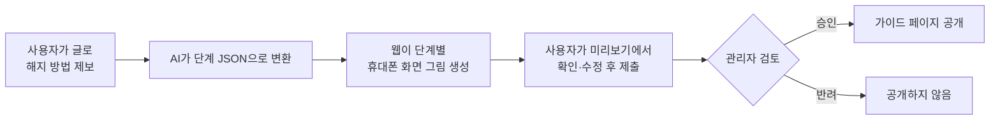

# 구독 해지 가이드 웹사이트 기획서

2026-11-11 작성 · 원본: [Claude Docs 기획서](https://claude.ai/artifact/L55CEY6kCXJ5qYvTNpi8L8)

## 1. 프로젝트 개요

구독 서비스 해지 방법을 검색 한 번으로 찾고, 사용자가 글로 쓴 해지 방법을 AI가 단계별 화면 그림으로 바꿔 보여주는 웹사이트를 3주 동안 혼자 만든다.

| 항목 | 내용 |
| --- | --- |
| 서비스명 | 구독 해지 가이드 |
| 한 줄 소개 | 구독 해지 방법을 단계별 그림으로 알려주는 가이드 사이트 |
| 개발 기간 | 3주 |
| 개발 인원 | 1명 (기획, 디자인, 개발) |
| 형태 | 반응형 웹 + PWA |
| 기술 스택 | Spring Boot 4, Java 21, Thymeleaf, Spring Data JPA, MySQL, Spring Security, Bootstrap 5, LLM API |

## 2. 기획 배경

구독 이용자 10명 중 6명이 해지에 어려움을 겪지만, 해지 방법은 서비스마다 다르고 한곳에 정리된 곳이 없다.

### 현황

- 서울시 조사에서 주요 온라인 구독 이용자 10명 중 6명이 해지에 어려움을 겪거나 원하지 않는 유료 전환을 겪었다. ([아이뉴스24](https://www.inews24.com/view/1834978))
- 1인당 평균 5.5개의 구독을 이용하고 있어, 쓰지 않는 구독료가 고정비로 빠져나간다. ([경기일보](https://www.kyeonggi.com/article/20260508580346))

### 원인

- 해지 버튼을 숨기거나 가입보다 해지 절차를 복잡하게 만드는 다크패턴
- 앱, 웹, 앱스토어 결제마다 다른 해지 경로
- 앱 화면이 자주 바뀌어 블로그에 올라온 설명이 금방 낡음

### 사회적 흐름

- 2026년 6월 19일 정부는 「생활밀착 서비스 개선방안」을 발표해 9월 구독 내역 통합 조회, 12월 다크패턴 금지 규정 신설을 추진한다. ([데일리안](https://www.dailian.co.kr/news/view/1657427))
- 방송미디어통신위원회는 "해지는 쉽게, 결제는 투명하게" 구독서비스 가이드를 공개했다. ([디지털데일리](https://www.ddaily.co.kr/page/view/2026052712100675445))
- 정부 조회 서비스는 결제 내역을 보여주지만, 서비스별 해지 방법까지 안내하지는 않는다.

### 왜 웹인가

해지하고 싶을 때 사람들은 앱을 설치하지 않고 "넷플릭스 해지 방법"처럼 검색부터 한다. 한 번 쓰고 끝내는 정보라 설치 없이 바로 열리고, 검색에 걸리고, 링크로 공유되는 웹이 맞다. 서비스별 가이드 페이지 하나가 검색 유입 창구 하나가 된다.

### 해결할 문제

구독 서비스는 계속 늘어나고 해지 방법도 자주 바뀌기 때문에 관리자 혼자 모든 가이드를 최신으로 유지할 수 없다. 사용자가 글로 해지 방법을 올리면 AI가 이를 단계별 화면 그림으로 바꿔 누구나 따라 할 수 있게 한다.

## 3. 목표

3주 안에 주요 구독 서비스 10개의 해지 가이드와 "글 → 화면 그림" AI 기능을 갖춘 사이트를 배포한다.

### 서비스 목표

- OTT, 음악, 쇼핑 멤버십 등 주요 구독 서비스 10개의 검증된 해지 가이드 제공
- 사용자가 글로 쓴 해지 방법을 AI가 단계로 나누고 화면 그림으로 보여주기
- 모바일과 PC 모두 지원하는 반응형, 홈 화면에 추가할 수 있는 PWA
- 검색엔진 노출: Google Search Console 등록, Lighthouse SEO·PWA 점수 90점 이상

### 개인 학습 목표

- Spring Boot로 Controller, JPA, CRUD, 검색·페이지 나누기, Spring Security 권한 처리를 직접 구현
- 외부 AI API를 호출하고 JSON 응답을 Java 객체로 변환해 DB에 저장하는 경험
- AI는 도구로 쓰되, 각 기능의 코드를 설명할 수 있을 때만 반영하고 단계마다 Git으로 기록

## 4. 타깃 사용자

주요 타깃은 구독을 해지하려고 검색하는 사람이고, 보조 타깃은 해지 방법을 알려주려는 사람이다.

| 페르소나 | 상황 | 필요한 것 |
| --- | --- | --- |
| 24세 대학생 | 무료체험 후 자동결제된 OTT를 해지하려는데 앱에서 해지 버튼을 못 찾아 "○○ 해지 방법"을 검색 | 휴대폰에서 바로 보는 단계별 화면 |
| 55세 직장인 | 자녀가 가입해 준 음악 구독을 해지하고 싶지만 방법을 모름, 자녀가 링크를 보내줌 | 큰 글씨, 누를 곳이 표시된 그림 |
| 29세 직장인 (제보자) | 방금 해지를 마쳤고, 사이트에 없는 서비스라 방법을 공유하고 싶음 | 캡처 없이 글만 써도 되는 제보 화면 |

## 5. 경쟁·참고 서비스 분석

기존 서비스는 해외 위주이거나, 결제 조회만 하거나, 정보가 흩어져 있다. 구독 해지 가이드는 한국 서비스의 해지 방법을 단계별 그림으로 모은다.

| 서비스 | 특징 | 아쉬운 점 | 구독 해지 가이드의 차별점 |
| --- | --- | --- | --- |
| [JustDeleteMe](https://justdeleteme.xyz) | 서비스별 탈퇴 난이도를 색상으로 표시 | 해외 서비스 위주, 단계 설명과 그림 없음 | 한국 서비스, 단계별 화면 그림 |
| 정부 구독 통합 조회 (2026.9~) | 금융 결제 내역으로 구독 조회 | 해지 방법은 안내하지 않음 | 해지 경로 안내에 집중 |
| 개인 블로그 글 | 검색에 잘 걸림 | 글마다 형식이 다르고 금방 오래됨 | 한곳에 모음, 피드백으로 최신 유지 |

벤치마크 대상은 JustDeleteMe다. 서비스 목록, 난이도 색상 표시, 검색 구조를 참고한다.

## 6. 주요 기능

3주 안에는 필수 기능과 핵심 기능만 만들고, 캡처 업로드와 내 구독 관리는 향후 확장으로 미룬다.

| 구분 | 기능 | 설명 |
| --- | --- | --- |
| 필수 | 서비스 목록 | 카테고리별(OTT, 음악, 쇼핑 멤버십 등) 목록, 해지 난이도 색상 표시 |
| 필수 | 검색 | 서비스명으로 검색, 결과가 없으면 "해지 방법 제보하기"로 연결 |
| 필수 | 해지 가이드 상세 | 단계별 설명, 환불 조건, 고객센터 정보, 마지막 확인일 |
| 필수 | 관리자 기능 | 관리자 로그인, 서비스와 가이드 등록·수정·삭제, 제보 승인·반려 |
| 핵심 | 단계 화면 그림 | 단계 정보(화면 이름, 누를 버튼, 위치)로 휴대폰 화면 도식을 그리고 누를 곳을 강조 |
| 핵심 | 글로 제보 → AI 단계 변환 | 사용자가 글로 쓴 해지 방법을 AI가 단계 JSON으로 바꾸고, 미리보기 그림을 보여줌 |
| 핵심 | 검증 표시와 피드백 | "사용자 제보·AI 변환" 배지, "이 방법이 맞았어요 / 달라요" 버튼 |
| 필수 | 반응형, SEO, PWA | Bootstrap 반응형, 페이지별 meta·Open Graph·sitemap.xml, manifest와 서비스 워커(오프라인 페이지) |
| 향후 | 캡처 업로드 | 실제 화면 캡처 위에 누를 곳 표시, 개인정보 가리기, AI가 캡처를 보고 설명 자동 작성 |
| 향후 | AI 이미지 생성 | "실제 화면과 다를 수 있어요" 표시를 붙인 예시 이미지 |
| 향후 | 회원가입 + 내 구독 관리 | 내 구독 등록, 월 총액, 결제일 알림 |

핵심 기능의 흐름은 아래와 같다. 사용자는 글만 쓰고, AI는 단계 정보만 만들며, 그림은 웹이 직접 그린다. AI가 화면 그림을 직접 그리면 없는 메뉴를 지어내거나 한글이 깨지기 때문이다.



관리자가 직접 입력한 가이드도 같은 화면 그림 템플릿을 쓰고, 반려된 제보는 공개하지 않는다.

## 7. 화면 구성

사용자 화면 5개와 관리자 화면 4개, 총 9개 화면으로 구성한다.

| 구분 | 화면 | URL | 주요 내용 |
| --- | --- | --- | --- |
| 사용자 | 메인 | `/` | 검색창, 카테고리, 인기 해지 가이드 |
| 사용자 | 카테고리 목록 | `/category/{name}` | 서비스 카드, 난이도 색상, 페이지 나누기 |
| 사용자 | 검색 결과 | `/search?q=` | 검색 결과, 없으면 제보 버튼 |
| 사용자 | 해지 가이드 상세 | `/guide/{slug}` | 단계별 화면 그림, 환불 조건, 검증 배지, 피드백 버튼 |
| 사용자 | 해지 방법 제보 | `/submit` | 서비스명과 방법 글 입력 → AI 변환 → 미리보기 → 제출 |
| 관리자 | 로그인 | `/admin/login` | 관리자 계정 로그인 |
| 관리자 | 가이드 관리 | `/admin/guides` | 목록, 등록·수정·삭제 |
| 관리자 | 가이드 편집 | `/admin/guides/{id}/edit` | 단계 정보 입력, 화면 그림 미리보기 |
| 관리자 | 제보 검토 | `/admin/submissions` | 사용자 제보 승인·반려, 피드백 현황 |

가이드 상세 URL은 `/guide/netflix`처럼 서비스 이름을 넣어 검색엔진과 사용자가 알아보기 쉽게 한다. 모바일에서는 단계 그림을 세로로 하나씩, PC에서는 가로로 나란히 보여준다.

## 8. 기술 구성

Spring Boot와 Thymeleaf로 서버에서 HTML을 완성해 보내므로, 검색엔진이 내용을 그대로 읽어 SEO에 유리하다.

### 기술 스택과 선택 이유

| 영역 | 기술 | 선택 이유 |
| --- | --- | --- |
| 백엔드 | Spring Boot 4, Java 21 | 학습 목표, 국내에서 가장 많이 쓰는 웹 프레임워크 |
| 화면 | Thymeleaf | 서버에서 HTML을 완성(SSR)해 검색 노출에 유리 |
| 디자인 | Bootstrap 5 | 반응형을 적은 코드로 구현 |
| 데이터 | Spring Data JPA, MySQL (개발 초기 H2) | 반복되는 SQL 없이 CRUD 구현 |
| 보안 | Spring Security | 관리자 화면 접근 제한 |
| AI | LLM API (`RestClient`로 호출) | 글을 단계 JSON으로 변환, API 키는 환경변수로 관리 |
| PWA | manifest.json, service-worker.js | `static` 폴더에 넣기만 하면 동작 |
| 배포 | 클라우드 서버 1대 (예: AWS EC2 프리티어) | PWA는 HTTPS가 필수 |

### 데이터 설계 (주요 테이블)

| 테이블 | 주요 컬럼 | 관계 |
| --- | --- | --- |
| category | id, name, slug | 1 : N service |
| service | id, category_id, name, slug, brand_color, difficulty, refund_info, verified_at | 1 : N guide_step |
| guide_step | id, service_id, step_order, screen_name, target_label, position, description | service에 속함 |
| submission | id, service_name, raw_text, ai_steps_json, status, created_at | 승인되면 service + guide_step으로 변환 |
| feedback | id, service_id, helpful, created_at | service에 속함 |

`submission.status`는 검토 대기, 승인, 반려 중 하나다. 관리자 계정은 3주 범위에서는 설정 파일의 고정 계정 1개로 충분하다.

> 구현 메모: `service` 테이블은 코드에서 Spring의 `@Service` 계층과 이름이 겹치지 않도록 `Subscription` Entity(`subscription` 테이블)로 만든다.

### AI 연동 방식

AI에는 "아래 형식의 JSON으로만 답하라"고 요청하고, 응답을 Java 객체로 변환해 검사한 뒤 저장한다.

```json
{
  "service": "넷플릭스",
  "steps": [
    {"order": 1, "screen": "홈", "target": "프로필 아이콘", "position": "top-right"},
    {"order": 2, "screen": "프로필", "target": "계정", "position": "middle"},
    {"order": 3, "screen": "계정", "target": "멤버십 해지", "position": "middle"}
  ]
}
```

화면 그림은 이 JSON을 받아 Thymeleaf 템플릿과 CSS로 휴대폰 틀, 메뉴 목록, 강조 표시를 그린다. 관리자가 직접 입력한 단계도 같은 템플릿을 쓴다.

## 9. 개발 일정

1주차에 기본 사이트, 2주차에 화면 그림과 AI, 3주차에 SEO·PWA·배포를 끝낸다. 각 주차가 끝날 때마다 동작하는 결과물이 남도록 순서를 정했다.

### 1주차: 기본 사이트

- [ ] 1일: 기획서 확정, 화면 스케치, Spring Boot 프로젝트 생성, Git 저장소
- [ ] 2일: Entity와 Repository (category, service, guide_step), H2로 시작
- [ ] 3~4일: 메인, 카테고리 목록, 가이드 상세 화면 (Controller + Thymeleaf)
- [ ] 5일: 검색과 페이지 나누기 (`Pageable`)
- [ ] 6~7일: 관리자 로그인(Spring Security), 가이드 등록·수정·삭제

### 2주차: 화면 그림과 AI

- [ ] 8~9일: 단계 화면 그림 템플릿 (휴대폰 틀, 메뉴, 강조 표시), 관리자 입력 데이터로 먼저 확인
- [ ] 10일: LLM API 연동, 글 → 단계 JSON 변환 테스트
- [ ] 11~12일: 제보 화면 (글 입력 → AI 변환 → 미리보기 → 제출)
- [ ] 13일: 관리자 제보 검토 (승인하면 가이드로 변환, 반려)
- [ ] 14일: 피드백 버튼과 검증 배지, 밀린 작업 정리

### 3주차: 반응형·SEO·PWA·배포

- [ ] 15~16일: 반응형 점검 (휴대폰, 태블릿, PC), 해지 가이드 10개 작성
- [ ] 17일: SEO (페이지별 title·description, Open Graph, sitemap.xml, robots.txt)
- [ ] 18일: PWA (manifest, 아이콘, 서비스 워커, 오프라인 페이지)
- [ ] 19일: MySQL 전환, 서버 배포, HTTPS 적용
- [ ] 20일: Lighthouse 측정, Google Search Console 등록, 버그 수정
- [ ] 21일: 발표 자료, 시연 영상, README 정리

일정이 밀리면 2주차 14일과 3주차 20일을 예비일로 쓴다. 그래도 부족하면 피드백 기능을 빼고, 화면 그림과 AI 제보는 남긴다.

## 10. 리스크와 기대 효과

가장 큰 리스크는 AI가 틀린 단계를 만드는 것이고, 사용자 확인·관리자 승인·피드백 3중 검증으로 대응한다.

### 리스크와 대응

| 리스크 | 대응 |
| --- | --- |
| AI가 없는 메뉴나 틀린 순서를 만듦 | AI는 사용자가 쓴 글만 단계로 나누고 내용을 더하지 않게 지시, 미리보기에서 사용자가 수정, 관리자 승인 후 공개 |
| AI 응답이 JSON 형식을 어김 | 형식 검사 후 실패하면 한 번 재요청, 그래도 실패하면 글만 저장 |
| AI API 비용과 악용 | 제보 글자 수와 하루 요청 횟수 제한, 변환 결과는 DB에 저장해 재사용 |
| API 키 유출 | 키는 환경변수로 관리하고 Git에 올리지 않음 |
| 해지 방법이 바뀌어 정보가 낡음 | 가이드마다 마지막 확인일 표시, "달라요" 피드백이 쌓이면 관리자 확인 |
| 실제 앱 화면과 상표를 그대로 흉내 내는 문제 | 화면 그림은 버튼 위치만 보여주는 단순 도식으로 그림 |
| 초보자라 일정 지연 | 주차마다 동작하는 결과물이 남도록 순서 구성, 예비일 2일 확보 |

### 기대 효과

- **사용자**: 해지 방법을 찾는 시간이 줄고, 원하지 않는 결제를 막는다.
- **사회**: 다크패턴을 드러내 쉽게 해지할 권리에 대한 인식을 넓힌다.
- **개인**: Spring 웹 개발의 전 과정(CRUD, 검색, 보안, 외부 API, 배포)을 경험하고, Lighthouse 점수와 검색 노출 수로 결과를 숫자로 보여준다.

## 출처

- [아이뉴스24: 서울시 구독 해지 조사](https://www.inews24.com/view/1834978)
- [경기일보: 1인당 평균 5.5개 구독](https://www.kyeonggi.com/article/20260508580346)
- [데일리안: 생활밀착 서비스 개선방안](https://www.dailian.co.kr/news/view/1657427)
- [디지털데일리: 방미통위 구독서비스 가이드](https://www.ddaily.co.kr/page/view/2026052712100675445)
- [JustDeleteMe](https://justdeleteme.xyz)

출처는 검색 결과 요약을 바탕으로 했으므로, 제출 전에 원문 기사의 수치와 발행일을 확인해야 한다.
